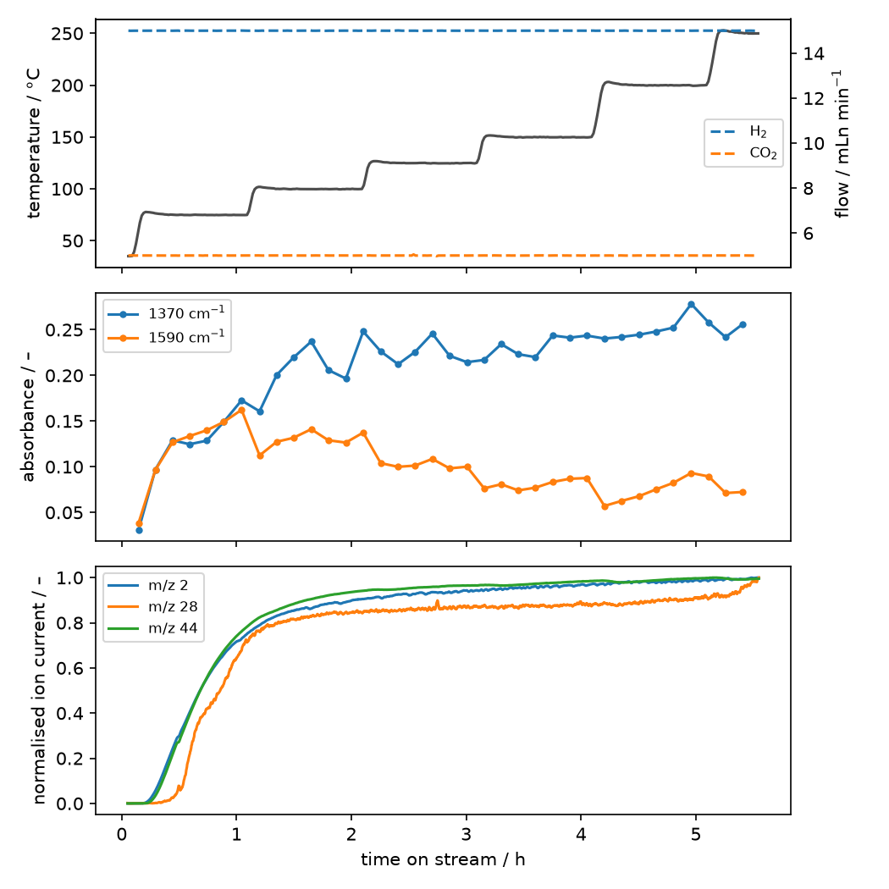

# Example: DRIFTS in Box 5

An operando DRIFTS run in Box 5 (building 67) records three things at once:

| what | instrument or software | reader |
|---|---|---|
| infrared spectra | Thermo OMNIC, a series of `.spa` files | `IRData.from_omnic_spa` |
| the gas phase | Pfeiffer Quadstar mass spectrometer, an `.asc` export | `MSData.from_quadstar_asc` |
| flows, pressures, cell temperature, the valve | LabVIEW `box5_drifts_v02.vi` until now, **box5-control** from its phase 10 | `ProcessData.from_labview_b67box5`, `ProcessData.from_day_log` |

The point of this example: one `tos_start` for all three, so one value of
`tos` is the same moment in every dataset, and the process data of LabVIEW
and of box5-control read into the same object, under the same tags.

The data is an anonymised excerpt of a real run in
[`examples/data/drifts_run/`](../../examples/data/drifts_run/) (40 spectra,
about six hours of MS and LabVIEW data); the notebook
[`drifts_ms_labview.ipynb`](../../examples/drifts_ms_labview.ipynb) runs the
same steps. Run the code from the repository root.

```
01_raw/box5/2026-03-26_run/
├── omnic/      Spectrum Index 1 at 0,00 Hours.spa, ...
├── ms/         drifts-ms_run.asc
└── labview/    2026-03-26_15-06-08.txt, ... (one per LabVIEW start)
```

## Read everything on one clock

```python
from pathlib import Path
import numpy as np
import pandas as pd
import lab_data_parser as ldp
from lab_data_parser.processdata import BOX5_CONTROL_TAGS

RUN = Path("examples/data/drifts_run")
tos_start = pd.Timestamp("2026-03-26 15:27:00", tz="Europe/Amsterdam")      # start of the reaction step

ir_raw = ldp.IRData.from_omnic_spa(RUN / "omnic", tos_start=tos_start)
ms_raw = ldp.MSData.from_quadstar_asc(RUN / "ms" / "drifts-ms_run.asc", tos_start=tos_start)
process_raw = (
    ldp.ProcessData.from_labview_b67box5(RUN / "labview", tos_start=tos_start)
    .rename_channels(BOX5_CONTROL_TAGS)          # LabVIEW's names onto box5-control's tags
    .scale("F2-5-Ar", 1.149 / 1.123)             # LabVIEW v02 used the He factor for Ar
)
```

```text
ir       2026-03-26 15:26:59+01:00  to  2026-03-26 21:18:08+01:00
ms       2026-03-26 15:15:00.390000+01:00  to  2026-03-26 21:34:52.430000+01:00
process  2026-03-26 15:15:03+01:00  to  2026-03-26 21:34:57+01:00
```

Each instrument keeps its own times; the spectra take the acquisition time
recorded inside every `.spa` (not the rounded hours in the file name), the MS
its cycle times, LabVIEW its rows. They only share the origin.

The LabVIEW folder holds three files, one per start of the VI, so the process
data has three sessions (139, 7 and 4412 rows); `process_raw.sessions` says
which file each came from.

```python
process_raw.channels
# ['Cell T', 'BPR Analytic', 'BPR Vent', 'F1-1-He', 'F1-2-H2', 'F1-3-CO2',
#  'F2-1-He', 'F2-2-H2', 'F2-3-CO2', 'F2-5-Ar', 'Valve']
process_raw.ds[["quantity", "unit", "species", "feed"]].to_dataframe()
```

> [!NOTE]
> **Why rename and scale.** After `rename_channels(BOX5_CONTROL_TAGS)` a
> LabVIEW run has the tags of box5-control (`Cell T`, `F1-1-He`, `Valve`), so
> one analysis reads old and new runs. The `scale` corrects a bug found when
> the LabVIEW VI was traced for box5-control: v02 multiplies the Ar reading by
> F1-He's correction factor (1.123) instead of its own (1.149), so every
> logged `F2 Ar PV` is 2.3 % low. Both steps are in the history.

## One window on all three

`select_timestamp_range` takes wall-clock bounds; a naive string is read in
the timezone of `tos_start`, so the times can be copied from the lab journal:

```python
start, end = "2026-03-26 15:30", "2026-03-26 21:00"
ir_window, ms_window, process_window = (d.select_timestamp_range(start, end)
                                        for d in (ir_raw, ms_raw, process_raw))
# 36 spectra, 1907 ms cycles, 3960 process rows
```

## Process each, the same way every run

```python
drifts = ldp.Pipeline([
    ("select_wavenumber_range", {"min_cm": 1000, "max_cm": 3900}),
    ("correct_baseline", {"anchor_range_cm": (2600, 2500),
                          "control_points_cm": [3900, 3450, 2720, 2500, 1850, 1000]}),
    ("smooth_savgol", {"window_length": 11, "polyorder": 3}),
], name="drifts example")

ir = drifts(ir_window)
ms = ms_window.correct_traces().mask_overloaded()
process = process_window.resample(60)
```

The pipeline is plain JSON (`drifts.to_json(folder / "pipeline.json")`) and
`Pipeline.from_history(ir)` gives it back from the processed data, ready for
the next run.



## The process values at every spectrum

Because the axes share an origin, the conditions of each spectrum are one
selection away:

```python
at_spectra = process_raw.ds["pv"].sel(tos=ir.tos, method="nearest")
at_spectra.sel(channel=["Cell T", "F2-3-CO2", "F2-2-H2"]).to_pandas().head()
```

```text
channel  Cell T  F2-3-CO2  F2-2-H2
tos
530.0    61.111     5.005   14.998
1055.0   76.667     5.006   14.992
1595.0   75.000     5.001   14.993
2125.0   74.444     4.995   14.989
2670.0   75.000     5.002   14.998
```

## With box5-control: valve switches for modulation excitation

In a modulation-excitation (ME) or step experiment the switching valve is
the instrument: the time of every switch is data. LabVIEW logged only the
feed on the cell every 5 s, so a switch time had to be read off the `Valve`
column:

```python
feed = process_raw.get_channel("Valve")
changes = np.flatnonzero(np.diff(feed) != 0) + 1
process_raw.tos[changes]            # array([330.]): feed 1 -> 2, to within one 5 s row
```

box5-control records every switch as an event of its own, with the time it
was seen (and, once it commands the valve, the time the command was sent and
the time the read-back confirmed it), the feed before and after, and the
programme step and ME cycle. `ProcessData.switches` puts them on the same
`tos` axis as the samples:

```python
box5 = ldp.ProcessData.from_day_log("01_raw/box5/data")      # here: tests/processdata/box5/data
box5.switches
```

```text
                       time   tos      kind  feed_before  feed_after sent                 confirmed  step  cycle               note
0 2026-10-23 09:01:00+02:00  60.0  observed          1.0         2.0  NaT 2026-10-23 09:01:00+02:00   NaN    NaN  seen by read-back
```

With the spectra read against the same origin, the switch times are the
cycle starts of the ME analysis, the measured ones rather than `k * period`,
so jitter does not smear the average:

```python
from lab_data_parser.spectroscopy.infrared import modulation

ir_me = ldp.IRData.from_omnic_spa(omnic_dir, tos_start=box5.tos_start)
cycle_starts = box5.switches.loc[box5.switches["feed_after"] == 2, "tos"].to_numpy()
folded = modulation.fold_cycles(ir_me, cycle_starts, period=120.0, n_discard=2)
one_period = modulation.average_cycles(folded)
```

The day log of box5-control holds more than LabVIEW's: an MFC's PV times its
correction factor (as LabVIEW logged it) and its own figure as `device_pv`,
the factor and its source as coordinates, the setpoints, a `status` per
value, and the event log (what failed, with its traceback). See
[Process data](../instruments/process-data.md) for the full layout.

## Store it

```
02_processed/<project>/2026-03-26_run/
└── 01_loaded/   ir.nc   ms.nc   process.nc   pipeline.json
```

```python
ir.to_netcdf(loaded / "ir.nc")
ms.to_netcdf(loaded / "ms.nc")
process_raw.to_netcdf(loaded / "process.nc")
drifts.to_json(loaded / "pipeline.json")
```

Nothing is written into `01_raw`. See
[Concepts: read once, cache as NetCDF](../concepts.md#read-once-cache-as-netcdf).

---

See also: [Spectroscopy](../instruments/spectroscopy.md),
[Mass spectrometry](../instruments/mass-spec.md),
[Process data](../instruments/process-data.md),
[examples/drifts_ms_labview.ipynb](../../examples/drifts_ms_labview.ipynb),
[examples/process_data.ipynb](../../examples/process_data.ipynb).
