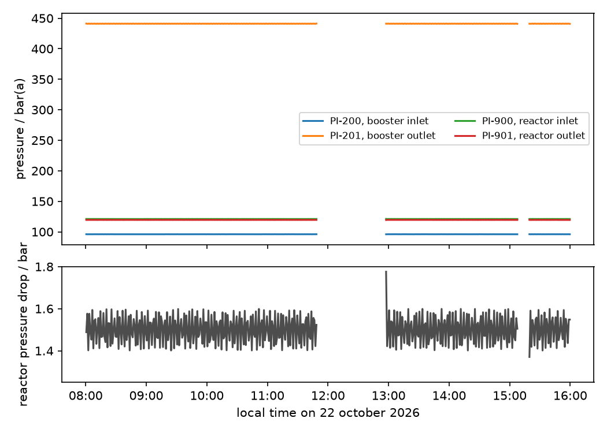

# Example: high pressure in Box 2

The Box 2 high-pressure set-up (building 67) is run by **box2-control**
([lab-control-b67box2-highpressuresetup](https://github.com/urakawa-group/lab-control-b67box2-highpressuresetup)).
It writes two files per day, and `ProcessData` reads both into one object:

```
01_raw/box2/
├── data/
│   ├── 2026-10-21_box2.csv      every channel's PV, SP and status, every second
│   └── 2026-10-22_box2.csv      a session running over midnight goes on here
└── logs/
    ├── 2026-10-21_box2.log      what happened: Connect, Arm, setpoints, errors
    └── 2026-10-22_box2.log
```

The files used here are in
[`examples/data/high_pressure_run/`](../../examples/data/high_pressure_run/):
a 17-hour session of box2-control in its **DEMO mode** (the devices are
simulated, the files are exactly what the rig writes), with every 10th row
kept to make the example small. Run the code from the repository root.

## Read the days

```python
from pathlib import Path
import numpy as np
import lab_data_parser as ldp

RUN = Path("examples/data/high_pressure_run")
box2_raw = ldp.ProcessData.from_day_log(RUN / "data")      # every day file; the events come from ../logs
box2_raw
```

```text
ProcessData(set_up='box2', n_samples=5654, channels=6, fields=['pv', 'status', 'sp'],
            sessions=1, events=126, duration=62759.3s, tos_start=2026-10-21 22:56:24.605407+02:00)
```

One session, two files: the session started at 22:56 on the 21st and ran
through the night, so it is one session with one origin, and `tos` runs on
across midnight. `tos_start` is the moment of Connect, as box2-control wrote
it, with its timezone.

```python
box2_raw.sessions[0]["tos_start"], box2_raw.sessions[0]["files"], box2_raw.sessions[0]["ambient_pressure"]
# ('2026-10-21T22:56:24.605407+02:00[Europe/Amsterdam]', ['2026-10-21_box2.csv', '2026-10-22_box2.csv'], 1.01325)
```

The session record also holds the complete settings of the bench at Connect
(`box2_raw.sessions[0]["settings"]`): ports, addresses, limits, log interval.
What a run was measured with is in the data, not in a lab journal.

## The channels

The channels are named with ISA-5.1 tags from the P&ID (`PI-900`: pressure
indicator, loop 900), and everything the header line says about them is a
coordinate:

```python
box2_raw.ds[["quantity", "unit", "device_unit", "description"]].to_dataframe()
```

```text
            quantity    unit  device_unit  description
channel
PI-200      pressure  bar(a)  bar(g)       booster inlet
PI-201      pressure  bar(a)  bar(g)       booster outlet
PI-202      pressure  bar(a)  bar(g)       H2 storage
PI-900      pressure  bar(a)  bar(g)       reactor inlet
PI-901      pressure  bar(a)  bar(g)       reactor outlet
TIC-001  temperature    degC    degC       demo heater zone
```

Every pressure is stored absolute: the Omega displays read gauge pressure,
and box2-control adds the session's ambient pressure before it writes.

## Was every reading good?

`status` says it for every value (`0` ok, `1` warning, `2` error, `3` idle),
and a failed reading is NaN, never a stale number:

```python
(box2_raw.ds["status"] == 0).mean("tos").to_series()
```

```text
PI-200     1.0
PI-201     1.0
PI-202     0.0
PI-900     1.0
PI-901     1.0
TIC-001    1.0
```

`PI-202`, the H₂ storage gauge, never answered. The event log says why, in
the software's own words:

```python
events = box2_raw.events
events["level"].value_counts()                     # INFO 117, WARNING 9
events.loc[events["level"] == "WARNING", ["time", "source", "text"]].head(3)
```

```text
                              time          source  text
2026-10-21 22:56:26.923000+02:00  devices.omega...  PI-202 (address 4) not answering on COM5 (9600 ...
2026-10-21 22:56:36.836000+02:00  service           armed for 60 min: writes allowed
2026-10-21 22:57:24.705000+02:00  service           disarmed (disarm pressed): going to the safe state
```

Every event has its `tos` too, so it can be drawn on the same axis as the
data, and an error carries its traceback in `detail`.

## Derived quantities

The values are plain arrays along `tos`, so derived quantities are one line.
The reactor pressure drop (LabVIEW's *P Delta*, `PDI-900` in the tag
convention):

```python
dp = box2_raw.get_channel("PI-900") - box2_raw.get_channel("PI-901")
np.nanmean(dp), np.nanstd(dp)          # (1.50, 0.28) bar
```

## A working day, on a one-minute grid

```python
box2 = (
    box2_raw
    .select_timestamp_range("2026-10-22 08:00", "2026-10-22 16:00")   # naive: read in Amsterdam time
    .select_quantity("pressure")
    .resample(60)
)
print(box2.format_history())
```

```text
1. from_day_log(path='examples/data/high_pressure_run/data', set_up=null, events=true, tos_start=null, keep_unknown=false)
2. select_timestamp_range(start='2026-10-22 08:00', end='2026-10-22 16:00', empty='warn')
3. select_quantity(quantity='pressure')
4. resample(step_s=60, method='mean')
```

The window cuts the events too (43 of 126 fall inside it). `resample` takes
the mean of the values and the *worst* status of each minute, so one failed
reading in a bin is not hidden by the good ones around it.



The gap between 11:50 and 12:57 is in the data: the event log shows the
polling slowed down (112, then 4 reads per 10 minutes instead of 568), and no
rows were written. Nothing is interpolated across it.

## With setpoints: controllers and MFCs

A controller's columns hold more than its value. The test file
`tests/processdata/box2/controller/2026-10-23_box2.csv` was written by
box2-control's own writer for an MFC (`FIC-500`) on a programme:

```python
mfc = ldp.ProcessData.from_day_log("tests/processdata/box2/controller/2026-10-23_box2.csv")
mfc.fields      # ['pv', 'status', 'sp', 'target', 'working', 'requested', 'owner', 'mode']
```

| field | meaning |
|---|---|
| `target` | where the controller should go (the programme's value) |
| `working` | what is written now: a ramp on its way to the target |
| `requested` | what was last asked for |
| `owner` | who set it: `0` manual, `1` programme, `2` ramp, `3` safety |
| `mode` | the MFC's control mode: `0` bus, `3` fully closed, `8` fully open |

and `state` (reading or controlling) and `estop` along time. When a zero
offset was set on a gauge while the file was written, `mfc.calibrations` says
when, by how much, and from which raw readings.

## Combine it with the other instruments

Every time-resolved class shares the clock, so a GC series or an MS run of
the same experiment lines up by giving them the same origin:

```python
tos_start = box2_raw.tos_start
gc = ldp.GCData.from_ezchrom_rslt(sorted(gc_dir.glob("0*/*.rslt"))).with_tos_start(tos_start)
pressure_at_injection = box2_raw.ds["pv"].sel(channel="PI-900").sel(tos=gc.tos, method="nearest")
```

## Store it

The CSV day files are the raw record and stay in `01_raw`. The processed run
goes to `02_processed` as one NetCDF file, with every value, status, event,
session and the history:

```python
box2_raw.to_netcdf(processed / "01_loaded" / "process.nc")     # 0.28 MB here, from 0.8 MB of CSV
box2_raw = ldp.ProcessData.from_netcdf(processed / "01_loaded" / "process.nc")
```

On a full day at 1 s the CSV is 7.0 MB and the NetCDF 1.4 MB. Why the rig
keeps writing CSV anyway, and when Zarr is worth it: see
[Process data: storage](../instruments/process-data.md#storage-csv-zarr-or-netcdf).

---

See also: [Process data](../instruments/process-data.md),
[examples/process_data.ipynb](../../examples/process_data.ipynb),
[Concepts: `tos_start`](../concepts.md#tos_start-anchoring-time-on-stream-to-the-clock).
